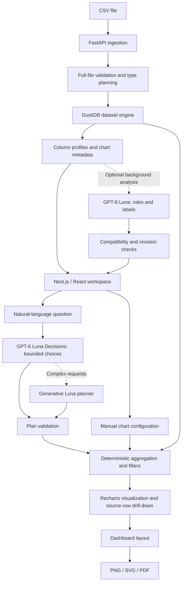

<div align="center">

<h1>
  
</h1>

**Turn CSV files into interactive charts and exportable dashboards.**

A local-first analytics workspace: ask questions in plain English, inspect the records behind a chart, and build a dashboard without writing analysis code.

[Demo](#demo) · [Features](#features) · [Architecture](#architecture) · [Run locally](#run-locally)

</div>

## Demo

https://github.com/user-attachments/assets/4c3df7ed-f755-4f2b-91f6-d5cb18f45186

### From a CSV to an answer

1. **Upload a CSV.** Analytico detects file settings, validates the data, and prepares the columns locally. Enable **AI column semantic analysis** for background role inference and readable labels.
2. **Ask a question or build a chart.** Try a comparison, trend, total, average, or count. Refine it with filters and inspect matching source rows. **Review data** is available whenever you want to change column settings.
3. **Keep and share the result.** Pin charts to a dashboard, arrange the layout, and export chart assets or a PDF report.

> [!TIP]
> Start with the included Gapminder dataset. Manual charts and local profiling work without an API key.

## Features

| Capability | What you can do |
| --- | --- |
| **Natural-language charts** | Include grouping, aggregation, and filters in your question. Clear supported requests produce a chart directly; material ambiguity receives clarification. |
| **Automatic CSV preparation** | Detect file settings, validate the full file, profile missing values, and recognize supported numeric, currency, percentage, and date formats. |
| **Optional AI column understanding** | GPT-6 Luna infers roles and readable labels in the background. Start charting after local preparation and edit the schema through **Review data**. |
| **Interactive exploration** | Build charts manually, apply structured filters, and drill into matching source rows. Overall answers appear as a single bar with its value. |
| **Dashboard builder** | Pin charts, drag and resize widgets, and save per-dataset layouts in browser storage. |
| **Exportable reports** | Download PNG/SVG chart assets or export a multi-page PDF dashboard. |

## Architecture

**AI selects the plan. The local engine computes the answer.** Natural-language questions and manual charts share the same aggregation, filtering, and drill-down logic.

- **Constrained chart planning.** GPT-6 Luna Decisions selects from real column keys, aggregations, chart styles and filter operands. A generative fallback handles more complex requests. Both receive dataset profiles, available descriptions and active filters, then use the same validated calculation engine.
- **Native data preparation.** CSVs use temporary disk-backed DuckDB at every size, preloaded at startup. Native loading overlaps structural validation; guarded column statistics and bounded previews avoid sending every row to the browser. Pandas remains a compatibility path.
- **Source-preserving interpretation.** Original CSV bytes are retained for the session, missing observations remain null, and conversions require full-column validation. AI display labels do not rename source keys or rewrite values.
- **Non-blocking enrichment.** A bounded background queue runs optional schema analysis. GPT-6 Luna Decisions classifies roles while Responses generates readable labels independently. Compatibility checks, user-override protection, and schema revisions prevent stale enrichment from overwriting reviewed choices.
- **Validated execution.** Model output must satisfy structured contracts and local checks before aggregation. Filters apply before calculation. Generated Python and model-written SQL are never executed; a dataset replacement invalidates an in-flight chart plan.



The backend separates ingestion, schema review, planning, aggregation, and enrichment into modules with validated request/response contracts. The frontend handles chart interactions, dashboard layout, and export rendering.

## Performance

Measured local engine preparation includes file validation, supported conversions, profiles, and chart metadata:

| Dataset | Rows | Measured local engine preparation |
| --- | ---: | ---: |
| NYC green taxi | 1,068,755 | 8.51 s |
| Online retail | 541,909 | 2.05 s |

Chart planning reached a **0.35-second median from question to computed chart**, down from 1.41 seconds, across supported requests on eight public datasets. This measures planning and calculation after ingestion. [Chart scorecard](backend/benchmarks/results/query-decisions-2026-10-07/summary.json) · [Ingestion scorecard](backend/benchmarks/results/guarded-production-2026-10-07/summary.json).

## Tech stack

| Layer | Technologies |
| --- | --- |
| Frontend | TypeScript, React 19, Next.js 16, Tailwind CSS |
| Visualization & interaction | Recharts, Framer Motion, react-grid-layout |
| Backend | Python, FastAPI, Pydantic |
| Data engine | DuckDB, pandas |
| AI | OpenAI GPT-6 Luna; Decisions, Responses, structured output and local validation |
| Export | html-to-image, jsPDF |
| Verification | Python unittest, TypeScript, frontend helper checks |

## Run locally

Use Python 3.11+ and a Node.js version compatible with Next.js 16. The tested backend environment is Python 3.14 on macOS. Python dependencies are pinned with hashes; frontend dependencies use `package-lock.json`.

```bash
git clone https://github.com/rayanical/analytico.git
cd analytico
```

**Backend**

```bash
cd backend
python -m venv venv
source venv/bin/activate
pip install --require-hashes --only-binary=:all: -r requirements.txt
cp -n .env.example .env
uvicorn main:app --host 127.0.0.1 --port 8000 --reload
```

On Windows, activate the virtual environment with `venv\Scripts\activate` and copy `.env.example` to `.env` using your shell.

**Frontend** — in a second terminal:

```bash
cd frontend
npm ci
npm run dev
```

Open [localhost:3000](http://localhost:3000). The included Gapminder dataset lets you explore immediately; the taxi demo requires a separately installed CSV.

### Enable AI

Add your own key to `backend/.env`, which is ignored by Git:

```dotenv
OPENAI_API_KEY=your_key_here
```

Chart planning and descriptions default to `gpt-6-luna`. The upload-time **AI column semantic analysis** toggle enables background role inference and a separate batched label request. Source headers remain visible when no AI or user label is available.

Chart planning uses Decisions by default. Set `QUERY_PLANNER_BACKEND=generative` in `backend/.env` to use the generative planner for every question.

> [!NOTE]
> Parsing and calculations run locally. Enabled AI features send bounded dataset context to OpenAI; configuring a key also enables background summary generation. Dataset sessions use memory or temporary disk storage and end when the backend restarts. Dashboard layouts are saved in browser storage, rather than restoring the underlying dataset. Run the backend on localhost.

## Project layout

```text
backend/
  modules/       CSV engine, column profiles, interpretation, AI contracts
  services/      Ingestion, query planning, aggregation, enrichment
  routers/       FastAPI endpoints
  tests/         Backend regression tests
  benchmarks/    Real-dataset experiments and measured scorecards
frontend/src/
  app/           Next.js workspace
  components/    Charts, data review, drill-down, dashboard
  context/       Dataset and interaction state
  lib/           API client, labels, filtering, storage, export
```

## Development checks

```bash
# Backend: from backend/ with the virtual environment active
pip install --require-hashes --only-binary=:all: -r requirements-dev.txt
python -m unittest discover -s tests -v

# Frontend: from frontend/
npx tsc --noEmit
npm run test:helpers
npm run lint
npm run build
```
